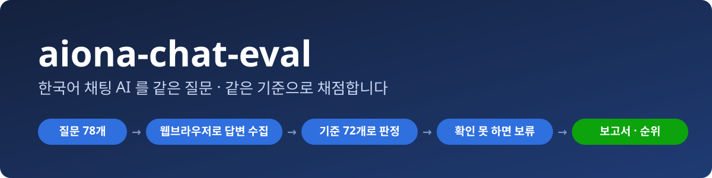
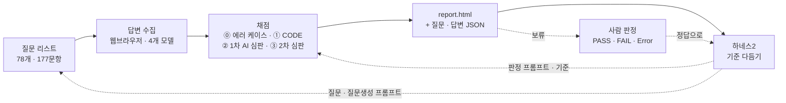
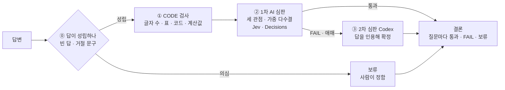
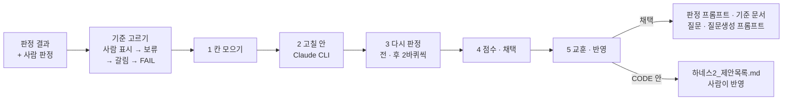

<p align="center">
  
</p>

<h1 align="center">aiona-chat-eval</h1>

<p align="center"><b>한국어 채팅 AI 를 같은 질문 · 같은 기준으로 채점하는 평가 프로그램</b></p>

<p align="center">
  <a href="https://github.com/yunjae305/aiona-chat-eval/actions/workflows/tests.yml"></a>
  <a href="LICENSE"></a>
  
  
  
  <a href="CHANGELOG.md"></a>
</p>

<p align="center"><code>질문 리스트 → 웹브라우저로 답변 수집 → 채점(프로그램 · AI 심판) → 보고서 → 하네스2(기준 다듬기)</code></p>

---

aiona-chat-eval 은 **AIONA · ChatGPT · Claude · Gemini 에 똑같은 질문을 보내고, 돌아온 답을 정해 둔 기준으로 채점해 순위와 근거를 남기는 프로그램**입니다. 벤치마크 점수가 아니라 실제로 쓰는 업무 질문 — 10번 이어 묻는 대화, 약 27만 토큰짜리 문서, 첨부 파일, "아무것도 출력하지 마" 같은 질문 — 에 대한 답을 봅니다. (옛 이름 ModelGrade)

> [!NOTE]
> 답은 **웹브라우저를 통해** 사용자가 쓰는 화면 그대로 수집합니다(API 호출이 아님). 그래서 처음 한 번은 수집용 Chrome 에서 네 사이트에 직접 로그인해야 하고, 그 뒤로는 프로그램이 알아서 받습니다.

## 한눈에



`aiona-chat-eval start` 하나로 수집 → 채점 → 보고서 → 하네스2 까지 묻지 않고 이어집니다. 실선은 한 번의 평가, 점선은 다음 평가를 낫게 하는 고리입니다.

| 들어 있는 것 | 수 | 하는 일 |
|---|---|---|
| **평가 기준** | 72개 | 답이 성립하는지 2 · 프로그램이 재는 것 26(글자 수 · 표 · 코드 · 계산값 …) · AI 심판이 보는 것 44(요청 수행 · 조건 준수 · 사실 · 앞뒤 맞음 · 대화 기억 … — 큰 기준 8 · 세부 기준 30·점검 항목 44) |
| **질문 세트** | 78개 | 싱글턴 57(첨부 12 · 빈 출력 요구 10 포함) · 10턴 대화 11 · 롱컨텍스트 10. 대화는 턴마다 채점(모두 177문항)하고, 10턴을 모두 통과해야 질문 1개 통과 |
| **비교 모델** | 4개 | AIONA · ChatGPT · Claude · Gemini (웹브라우저로 답변 수집, 모델 · 추론 수준을 맞춰서) |
| **심판** | 3단계 | ① 프로그램(CODE) ② 1차 AI 심판 — 같은 답을 세 가지 관점으로 한 번씩 보고 다수결 ③ 어겼다고 보거나 애매하면 2차 심판(Codex)이 답을 인용해 확정 |
| **결과** | 2개 파일 | `report.html` 보고서 하나(순위 · 분야별 · 기준별 · 걸린 시간 · FAIL 원인 · 보류 정하기 · 질문별 원문) + 질문 · 답변 JSON 하나 |
| **하네스2** | 평가 뒤 자동 | 흔들리거나 사람 판정과 어긋난 기준을 골라 판정 프롬프트 · 기준 · 질문을 고쳐 보고, 다시 판정해 나아진 것만 반영 |

## 빠른 시작

명령 세 개면 됩니다. 설치 명령 하나가 파이썬 · Chrome · Node.js · Codex CLI · Claude CLI · 패키지 · `aiona-chat-eval` 명령까지 깔고(없는 것은 Windows 는 winget, macOS 는 Homebrew 로), 끝에 처음 설정을 이어서 묻습니다.

**1. 설치** — Windows (PowerShell)

```powershell
irm https://raw.githubusercontent.com/yunjae305/aiona-chat-eval/main/install.ps1 | iex
```

**1. 설치** — macOS · Linux (터미널)

```bash
curl -fsSL https://raw.githubusercontent.com/yunjae305/aiona-chat-eval/main/install.sh | bash
```

**2. 처음 설정** — 키 입력 · CLI 로그인 · 네 사이트 로그인 · 점검 (설치 끝에 자동으로 이어짐)

```bash
aiona-chat-eval setup
```

**3. 평가 시작**

```bash
aiona-chat-eval start
```

<details>
<summary><b>Windows 에서 처음 설치하는 분 — 단계별로</b></summary>

1. 시작 메뉴에서 **PowerShell** 을 엽니다(관리자 아님).
2. 위 설치 명령을 붙여 넣고 Enter. `~/aiona-chat-eval` 에 받아지고(예전에 `~/ModelGrade` 에 깔았으면 그 폴더), 없는 프로그램은 winget 으로 설치합니다.
3. 설치가 끝나면 처음 설정이 이어집니다.
   - **키 입력**: `OPENAI_API_KEY`(필수) · `TYPESAFE_API_KEY`(권장) · AIONA 아이디 · 비밀번호. 입력은 화면에 보이지 않고 `.env` 에만 저장됩니다.
   - **CLI 로그인**: `codex login` · `claude auth login` 이 브라우저를 엽니다.
   - **사이트 로그인**: 수집용 Chrome 에 ChatGPT · Claude · Gemini · AIONA 창이 열리면 한 번씩 로그인합니다.
4. **새 PowerShell 창**을 열고 `aiona-chat-eval start` — 이제 어느 폴더에서나 됩니다(옛 이름 `modelgrade` 도 됨).
5. 무언가 빠졌는지 보려면 `aiona-chat-eval doctor`.

</details>

## 필요한 것

| 무엇 | 왜 | 비고 |
|---|---|---|
| Python 3.10+ · Google Chrome · Node.js | 실행 · 수집용 브라우저 · CLI | 설치 명령이 없으면 깔아 줌 |
| **OpenAI API 키** | 1차 심판(Decisions) | 필수 |
| TypeSafe API 키 | 1차 심판(Jev, 짧은 단일 질문) | 권장 — 없으면 Decisions 가 맡음 |
| ChatGPT 계정 | 2차 심판(Codex CLI) · 답변 수집 | |
| Claude 계정 | 답변 수집 · 새 질문 리스트 만들기(Claude Code) | |
| Gemini · AIONA 계정 | 답변 수집 | AIONA 는 크레딧이 남아 있어야 함 |

확인한 CLI 버전(2026-10-26): **Codex CLI 0.164.0** · **Claude Code 2.1.310**. 이보다 옛 판(Codex 0.164.0 · Claude Code 2.1.280 미만)이면 설치 명령과 `aiona-chat-eval doctor` 가 최신으로 올리라고 알립니다.

> [!WARNING]
> 비밀번호 · API 키는 `.env` 에만 들어가고 git 에 올라가지 않습니다. 어떤 키를 어디서 받는지는 [`.env.example`](.env.example) 주석에 있습니다.

## 쓰기 시작하기

`aiona-chat-eval start` 를 부르면 먼저 어떤 질문 리스트로 할지 묻습니다.

| 번호 | 고르면 | 언제 |
|---|---|---|
| **1** | 기존 질문 리스트(78개) — 받아 둔 답이 있으면 바로 평가, 빠진 답만 먼저 받음 | 보통은 이것 |
| **2** | 새 질문 리스트 만들기 — 질문생성 프롬프트를 Claude Code 가 따라 질문 · 첨부 · 긴 문서를 만들고, 검사를 통과할 때까지 고침 | 질문 세트를 바꿔 보고 싶을 때(여러 시간, 멈춰도 이어서) |
| **3** | 기존 리스트로 답변 새로 받기 | AIONA 가 업데이트됐을 때 |

수집과 평가는 모델마다 한 줄씩 그 자리에서 숫자가 바뀌는 진행 판으로 보입니다.

```text
답변수집을 진행합니다.
  AIONA   : 12 / 78  (남은 66) · Q13 받는 중
  ChatGPT : 15 / 78  (남은 63) · Q16 받는 중 (3/10턴)
  Claude  : 18 / 78  (남은 60) · Q19 받는 중
  Gemini  : 11 / 78  (남은 67) · Q12 받는 중
...
평가가 완료되었습니다.
  보고서  …/참고자료/결과/2026-10-27_07-07-42-013/report.html

하네스2(기준 다듬기)를 시작합니다 — 기준 2개까지, 시간 한도 없이. 끝나면 반영한 것과 사람이 볼 제안을 알립니다.
```

수집이 끝나면 묻지 않고 바로 평가하고, 보고서가 만들어지면 이어서 [하네스2](#하네스2--평가-뒤-기준-다듬기) 가 돕니다(끄려면 `--refine off`).

| 하고 싶은 것 | 명령 |
|---|---|
| 평가 (메뉴에서 고르기) | `aiona-chat-eval start` |
| AIONA 와 짝 앱을 같은 모델로 (예: GPT-5.6 Sol — ChatGPT 도 GPT-5.6 Sol 로) | `aiona-chat-eval start --aiona "GPT-5.6 Sol"` |
| 보고서를 열어 보류 정하기 — 누르면 바로 저장 | `aiona-chat-eval review` |
| 수집용 Chrome 띄우기 · 다시 로그인 | `aiona-chat-eval login` |
| 빠진 것 점검 | `aiona-chat-eval doctor` |
| 처음 설정 다시 | `aiona-chat-eval setup` |

멈추거나 끊겨도 **같은 명령을 다시 부르면 이어서** 합니다 — 받은 답 · 판정은 질문마다 저장됩니다. 옛 이름 `modelgrade` 로 불러도 같습니다. 개발 · 운영 명령(다시 판정 · 비교 · 기준 다듬기 루프 · 시험)은 [CONTRIBUTING.md](CONTRIBUTING.md) 에 있습니다.

## 결과 — 무엇을 얻나

평가마다 `참고자료/결과/<시작 시각>/` 폴더 하나가 생기고 git 에 함께 올라갑니다. 들어 있는 것은 두 파일뿐입니다.

```text
참고자료/결과/2026-10-27_07-07-42-013/
├── 50ca3ccccace_결과_판정결과.json   질문 · 답변 — 질문 원문(턴마다 · 참조 자료), 모델마다 받은 답 · 수집 기록, 기준마다 판정 · 사유, 사람 판정
└── report.html                       보고서 — 순위 · 분야별 · 기준별 · CODE 검사 · 걸린 시간 · FAIL 원인 · 보류 정하기 · 질문별 원문
```

판정 원자료 · 심판 호출 기록 · 답변 수집 로그는 이 PC 의 `data/judge_runs/<실행>/` 에 남습니다(git 에는 안 올라감).

**최종 순위** — 2026-10-27, 받아 둔 답을 지금 판정 흐름으로 다시 판정 ([보고서](참고자료/결과/2026-10-27_07-07-42-013/report.html))

| 순위 | 모델 | 통과한 질문 / 78 |
|---|---|---|
| 1 | ChatGPT (GPT-6) | 55 |
| 2 | AIONA (자동 추천) | 52 |
| 3 | Claude (Sonnet 5.5) | 47 |
| 4 | Gemini (3.8 Flash) | 47 |

같은 수는 턴마다 센 문항 통과 수로 가립니다(Claude 112 · Gemini 84 / 177). 빈 출력 요구 10개 질문은 보류로 셉니다. 보류(ChatGPT 3 · AIONA 3 · Claude 2 · Gemini 5개 질문)도 평가 결과이고, 보고서에서 사람이 정하면 그 결과로 다시 셉니다.

## 어떻게 평가하나



- **질문마다 노리는 기준만** 봅니다. 질문 하나가 노리는 기준은 6~10개(+ 늘 보는 기본 기준)이고, 기준마다 질문 10개 이상에서 평가되게 짰습니다.
- **하나라도 어기면 FAIL**, 근거(답 인용) 없이는 FAIL 을 주지 않습니다. 인용이 원문에 실제로 있는지, 사유와 판정이 맞는지를 프로그램이 다시 확인합니다.
- **확인할 수 없으면 추측하지 않고 보류**로 남겨 사람이 정합니다. 정한 판단은 기록으로 쌓여 다음 판정에 쓰입니다.
- **순위는 통과한 질문 수(/ 78)**로 매깁니다. 10턴 대화는 10턴을 모두 통과해야 질문 1개 통과입니다(턴마다 센 문항 / 177 은 보고서에 보조로).
- 기준의 원본은 [채팅품질 평가기준 v2](참고자료/기준/채팅품질%20평가기준_v2.md) — 기준 72개 · 판정 체계 · 결론 규칙 · 안전장치.

## 하네스2 — 평가 뒤 기준 다듬기

보고서가 만들어지면 하네스2 가 이어서 돕니다. 판정이 흔들리거나 사람 판정과 어긋난 LLM 기준을 골라, 고칠 안을 내고 **같은 답을 고치기 전 · 후로 다시 판정해 나아진 것만** 반영합니다. 반영한 것은 다음 평가부터 쓰입니다.



| 고치는 것 | 반영하는 조건 |
|---|---|
| 판정 프롬프트(1차 · 2차 심판이 함께 읽는 기준 정의, 판정 태도 3종 포함) · 평가 기준(기준 원본 문서와 함께) | 고치기 전 · 후로 2바퀴씩 다시 판정 — 사람 판정과 더 맞고, 뒤집힘이 늘지 않고, 다른 기준은 그대로일 때만 |
| 질문 리스트(질문 글 · 멀티턴 턴별 정답 메모) · 질문생성 프롬프트 | 세트 검사(구성 · 기준 6~10 · 적용 수 · 길이)를 통과하고, 그 기준 칸이 흔들리거나 사람 판정과 어긋날 때만. 고친 질문은 다음 수집 때 그 질문만 다시 받아 다시 판정 |
| CODE 검사 코드 | 자동으로 넣지 않고 [하네스2 제안목록](참고자료/문서/하네스2_제안목록.md)에 쌓음 |

반영하면 [변경내역](참고자료/변경내역/)에 적고 버전(부)을 올립니다. 시간 한도는 없고, 한 번에 기준 2개까지(`--refine-items`)입니다. 다시 판정 한 바퀴가 수십 분이라 기준 하나에 몇 시간 걸립니다. 끊겨도 다시 부르면 끝낸 기준은 건너뛰고 이어서 합니다.

터미널에는 기준마다 이렇게 뜹니다.

```text
하네스2(기준 다듬기)를 시작합니다 — 기준 2개까지, 시간 한도 없이. 끝나면 반영한 것과 사람이 볼 제안을 알립니다.
하네스2 — 다듬을 기준: J3-5.a(사람 표시 … · 보류 … · 갈림 … · FAIL …) · …

하네스2 작업 중 [1/2] J3-5.a — 14:05 시작
── 1/5 칸 모으기 — FAIL · 보류 칸과 같은 수의 통과 칸
── 2/5 고칠 안 만들기 — claude CLI
── 3/5 다시 판정 — 지금 그대로(base) 2바퀴 + 안 2개 × 2바퀴 (한 바퀴에 수십 분)
base r1: 판정 22건 → … …
   끝 — 종료 코드 0 · 1864초
── 4/5 점수 · 채택 — 사람 판정과 맞는지 · 뒤집힘 · 다른 기준 영향
── 5/5 교훈 · 반영
하네스2 [1/2] J3-5.a 끝 — 3시간 5분
…
하네스2 결과 — 기준 2개 · 6시간 20분
  J3-5.a: P1 채택 · P2 기각 → 반영 P1
하네스2 작업이 끝났습니다. 반영한 것은 다음 평가부터 쓰입니다.
```

따로 돌리려면 `python -X utf8 tools/refine_loop.py auto --run <실행>` ([CONTRIBUTING.md](CONTRIBUTING.md)).

## 왜 aiona-chat-eval 인가

| 흔한 방식 | aiona-chat-eval |
|---|---|
| 답 하나에 점수 하나 | 기준마다 지켰는지 따로 — **어느 기준에서 떨어졌는지** 남음 |
| 공개 벤치마크 문제 | 실제 업무 질문 · 10턴 대화 · 27만 토큰 문서 · 첨부 · 질문마다 설계한 함정 |
| API 로 호출 | **웹브라우저를 통해** 사용자가 쓰는 화면 그대로 답변 수집(서비스 설정 · 모델 · 추론 수준을 맞춰서) |
| 심판이 확신 없이도 판정 | 근거 없으면 FAIL 없음, 확인 못 하면 **보류 → 사람**(보고서 안에서 바로 정함) |
| 한 번 만들고 끝 | 평가가 끝나면 **하네스2** 가 결과 · 사람 판정으로 판정 프롬프트 · 기준 · 질문을 다듬음(다시 판정해 나아진 것만), 새 질문 리스트도 프로그램이 만듦 |
| 걸린 시간 · 비용을 모름 | 질문마다 수집 · 평가 시간, 심판별 호출 수 · 토큰을 기록 |

## 지원 환경

| 환경 | 상태 |
|---|---|
| Windows 10 · 11 | 주 개발 환경 · CI 시험 |
| macOS | CI 시험(설치 · 전역 명령) |
| Linux | CI 시험(이식성) |

**고를 수 있는 모델** — 답변 수집은 모두 웹브라우저 · 답 아래 복사 버튼 원문입니다. 추론 수준은 고정(ChatGPT Medium · Claude 노력 중간 · Gemini 사고 보통).

| 서비스 | 고를 수 있는 모델 — 모두 고를 수 있음 · **굵게** = 아무것도 안 고르면 쓰는 기본값 |
|---|---|
| ChatGPT | **GPT-6** · GPT-5.6 Sol |
| Claude | Opus 5.5 · Fable 5.1 · **Sonnet 5.5** · Haiku 5.5 · Haiku 4.5 · Sonnet 5 · Opus 5 · Fable 5 · Opus 4.8 · Opus 4.7 · Opus 4.6 · Sonnet 4.6 |
| Gemini | 3.5 Flash-Lite · **3.8 Flash** · 3.1 Pro · 4 Argon |
| AIONA (dev.aiona.kr) | **자동 추천** · Claude Opus 5.5 · Claude Fable 5.1 · Claude Sonnet 5.5 · Claude Haiku 5.5 · Claude Haiku 4.5 · Claude Sonnet 5 · Claude Opus 5 · Claude Fable 5 · Claude Opus 4.8 · Claude Opus 4.7 · Claude Opus 4.6 · Claude Sonnet 4.6 · GPT-6 Sol · GPT-5.6 Sol · Gemini 3.5 Flash-Lite · Gemini 3.8 Flash · Gemini 3.1 Pro Preview · Gemini 4 Argon |

AIONA 에서 모델을 고르면 짝인 앱도 같은 모델로 함께 받습니다 — 예: `--aiona "Claude Opus 5.5"` 면 Claude 도 Opus 5.5, `--aiona "GPT-6 Sol"` 이면 ChatGPT 도 GPT-6. 앱 모델로 고를 수도 있습니다(`--model claude:Opus 5.5` 면 AIONA 는 Claude Opus 5.5). 고르지 않으면 네 모델 모두 기본값(AIONA 자동 추천)입니다.

<details>
<summary><b>문제 해결</b></summary>

| 증상 | 할 일 |
|---|---|
| 사이트 로그인이 풀렸다 | `aiona-chat-eval login` 으로 창을 열고 다시 로그인 — 수집 전에도 로그인 화면이 남은 창을 알려 줍니다 |
| 수집 · 평가가 중간에 멈췄다 | 같은 명령을 다시 — 받은 답 · 판정은 건너뛰고 이어서 |
| AIONA 답이 '월간 크레딧 한도를 초과했습니다' | 크레딧을 충전한 뒤 같은 명령 — 그 질문부터 다시 받음(한도 문구는 답으로 저장하지 않음) |
| Codex 가 판정 모델을 못 부른다 | `npm install -g @openai/codex@latest` (0.164.0 이상) |
| 보류가 많다 | `aiona-chat-eval review` 로 보고서를 열어 질문마다 통과 · FAIL 을 누르면 바로 저장되고, '숫자 다시 계산'으로 순위가 바뀝니다 |

</details>

## 더 보기

- **기준 원본** — [참고자료/기준/채팅품질 평가기준_v2.md](참고자료/기준/채팅품질%20평가기준_v2.md)
- **버전 · 변경 이력** — [CHANGELOG.md](CHANGELOG.md)(시맨틱 버저닝 주.부.수정, 지금 버전은 `aiona-chat-eval --version`) · 날마다의 자세한 변경은 [참고자료/변경내역/](참고자료/변경내역/)
- **하네스2 제안목록** — [참고자료/문서/하네스2_제안목록.md](참고자료/문서/하네스2_제안목록.md)(하네스2 가 자동으로 넣지 않은 CODE 검사 개선 · 확장)
- **개발 · 운영 명령과 폴더 구조** — [CONTRIBUTING.md](CONTRIBUTING.md)
- **기준 확장 계획(공개 데이터 기준)** — [참고자료/문서/기준_확장목록_공개데이터.md](참고자료/문서/기준_확장목록_공개데이터.md)

## 라이선스

[Apache License 2.0](LICENSE) · 바깥 자료와 의존성은 [THIRD_PARTY_NOTICES.md](THIRD_PARTY_NOTICES.md)

<details>
<summary>English summary</summary>

aiona-chat-eval (formerly ModelGrade) is a reproducible quality evaluation for Korean chat assistants. It sends the same 78 real-use questions (single-turn, 10-turn conversations, attachments, ~270K-token long context, explicit-empty-output) to AIONA, ChatGPT, Claude and Gemini through their web UIs in a browser, then judges every answer against 72 criteria — 2 error-case checks, 26 deterministic CODE checks and 44 LLM-judged items, only those each question targets. LLM judging runs three judging stances once each with a weighted majority, and a second judge (Codex CLI) confirms failing or uncertain items by quoting the answer. Cells that cannot be verified are held for a human, who decides them inside the single report. Models are ranked by questions fully passed (/78 — a conversation passes only if all 10 turns pass).

Quick start: `irm https://raw.githubusercontent.com/yunjae305/aiona-chat-eval/main/install.ps1 | iex` (Windows) or `curl -fsSL https://raw.githubusercontent.com/yunjae305/aiona-chat-eval/main/install.sh | bash` (macOS · Linux), then `aiona-chat-eval setup` → `aiona-chat-eval start`.

</details>
