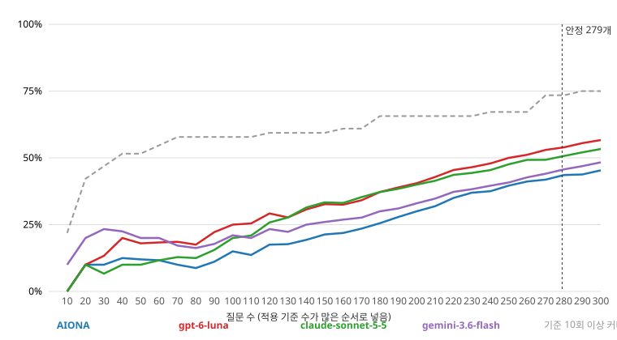

# 기울기 그래프 — 실행 21ca99659c2d

질문을 적용 기준 수(k_var)가 많은 순서로 넣었다. k 분포: {1: 16, 2: 25, 3: 22, 4: 21, 5: 21, 6: 22, 7: 23, 8: 15, 9: 20, 10: 16, 11: 18, 12: 15, 13: 18, 14: 17, 15: 16, 16: 15}. 기준 64개(질문으로 셀 수 있는 것), 통과율 = PASS / 질문 수(보류·수집 실패 포함). 순위 안정 허용 오차 ±3pp.

- 모든 기준이 1회 이상 적용되는 질문 수: **전체로도 미달**
- 모든 기준이 10회 이상 적용되는 질문 수: **전체로도 미달**
- 모델 순위·통과율이 안정되는 질문 수: **279** (전체 순위: gpt-6-luna > claude-sonnet-5-5 > gemini-3.6-flash > AIONA)

| 질문 수 | 기준 1회↑ | 기준 10회↑ | AIONA PASS·FAIL·보류 (통과율) | gpt-6-luna PASS·FAIL·보류 (통과율) | claude-sonnet-5-5 PASS·FAIL·보류 (통과율) | gemini-3.6-flash PASS·FAIL·보류 (통과율) | 순위 |
|---|---|---|---|---|---|---|---|
| 10 | 44 | 14 | 0·10·0 (0%) | 0·9·1 (0%) | 0·8·2 (0%) | 1·9·0 (10%) | gemini > AIONA > claude > gpt-6- |
| 20 | 47 | 27 | 2·18·0 (10%) | 2·16·2 (10%) | 2·16·2 (10%) | 4·16·0 (20%) | gemini > AIONA > claude > gpt-6- |
| 30 | 47 | 30 | 3·27·0 (10%) | 4·24·2 (13%) | 2·26·2 (7%) | 7·23·0 (23%) | gemini > gpt-6- > AIONA > claude |
| 40 | 47 | 33 | 5·35·0 (12%) | 8·29·3 (20%) | 4·32·4 (10%) | 9·28·3 (22%) | gemini > gpt-6- > AIONA > claude |
| 50 | 47 | 33 | 6·44·0 (12%) | 9·37·4 (18%) | 5·40·5 (10%) | 10·37·3 (20%) | gemini > gpt-6- > AIONA > claude |
| 60 | 47 | 35 | 7·52·1 (12%) | 11·44·5 (18%) | 7·48·5 (12%) | 12·44·4 (20%) | gemini > gpt-6- > AIONA > claude |
| 70 | 48 | 37 | 7·61·2 (10%) | 13·52·5 (19%) | 9·56·5 (13%) | 12·52·6 (17%) | gpt-6- > gemini > claude > AIONA |
| 80 | 48 | 37 | 7·71·2 (9%) | 14·61·5 (18%) | 10·65·5 (12%) | 13·60·7 (16%) | gpt-6- > gemini > claude > AIONA |
| 90 | 48 | 37 | 10·76·4 (11%) | 20·64·6 (22%) | 14·70·6 (16%) | 16·66·8 (18%) | gpt-6- > gemini > claude > AIONA |
| 100 | 48 | 37 | 15·79·6 (15%) | 25·68·7 (25%) | 20·74·6 (20%) | 21·71·8 (21%) | gpt-6- > gemini > claude > AIONA |
| 110 | 48 | 37 | 15·88·7 (14%) | 28·74·8 (25%) | 23·79·8 (21%) | 22·77·11 (20%) | gpt-6- > claude > gemini > AIONA |
| 120 | 52 | 38 | 21·92·7 (18%) | 35·77·8 (29%) | 31·80·9 (26%) | 28·78·14 (23%) | gpt-6- > claude > gemini > AIONA |
| 130 | 52 | 38 | 23·98·9 (18%) | 36·83·11 (28%) | 36·84·10 (28%) | 29·85·16 (22%) | claude > gpt-6- > gemini > AIONA |
| 140 | 52 | 38 | 27·102·11 (19%) | 43·84·13 (31%) | 44·85·11 (31%) | 35·87·18 (25%) | claude > gpt-6- > gemini > AIONA |
| 150 | 52 | 38 | 32·106·12 (21%) | 49·87·14 (33%) | 50·88·12 (33%) | 39·92·19 (26%) | claude > gpt-6- > gemini > AIONA |
| 160 | 54 | 39 | 35·110·15 (22%) | 52·90·18 (32%) | 53·92·15 (33%) | 43·95·22 (27%) | claude > gpt-6- > gemini > AIONA |
| 170 | 54 | 39 | 40·113·17 (24%) | 58·93·19 (34%) | 60·94·16 (35%) | 47·98·25 (28%) | claude > gpt-6- > gemini > AIONA |
| 180 | 54 | 42 | 46·115·19 (26%) | 67·93·20 (37%) | 67·94·19 (37%) | 54·98·28 (30%) | claude > gpt-6- > gemini > AIONA |
| 190 | 54 | 42 | 53·117·20 (28%) | 74·96·20 (39%) | 73·97·20 (38%) | 59·101·30 (31%) | gpt-6- > claude > gemini > AIONA |
| 200 | 54 | 42 | 60·119·21 (30%) | 81·98·21 (40%) | 80·100·20 (40%) | 66·102·32 (33%) | gpt-6- > claude > gemini > AIONA |
| 210 | 54 | 42 | 67·121·22 (32%) | 90·99·21 (43%) | 87·101·22 (41%) | 73·103·34 (35%) | gpt-6- > claude > gemini > AIONA |
| 220 | 54 | 42 | 77·121·22 (35%) | 100·99·21 (45%) | 96·101·23 (44%) | 82·104·34 (37%) | gpt-6- > claude > gemini > AIONA |
| 230 | 54 | 42 | 85·122·23 (37%) | 107·100·23 (47%) | 102·103·25 (44%) | 88·105·37 (38%) | gpt-6- > claude > gemini > AIONA |
| 240 | 54 | 43 | 90·125·25 (38%) | 115·101·24 (48%) | 109·103·28 (45%) | 95·107·38 (40%) | gpt-6- > claude > gemini > AIONA |
| 250 | 54 | 43 | 99·125·26 (40%) | 125·101·24 (50%) | 119·103·28 (48%) | 102·107·41 (41%) | gpt-6- > claude > gemini > AIONA |
| 260 | 54 | 43 | 107·126·27 (41%) | 133·102·25 (51%) | 128·104·28 (49%) | 111·108·41 (43%) | gpt-6- > claude > gemini > AIONA |
| 270 | 54 | 47 | 113·126·31 (42%) | 143·102·25 (53%) | 133·106·31 (49%) | 119·109·42 (44%) | gpt-6- > claude > gemini > AIONA |
| 280 | 54 | 47 | 122·127·31 (44%) | 151·104·25 (54%) | 142·106·32 (51%) | 128·110·42 (46%) | gpt-6- > claude > gemini > AIONA |
| 290 | 54 | 48 | 127·127·36 (44%) | 161·104·25 (56%) | 151·106·33 (52%) | 136·111·43 (47%) | gpt-6- > claude > gemini > AIONA |
| 300 | 54 | 48 | 136·128·36 (45%) | 170·105·25 (57%) | 160·106·34 (53%) | 145·112·43 (48%) | gpt-6- > claude > gemini > AIONA |
