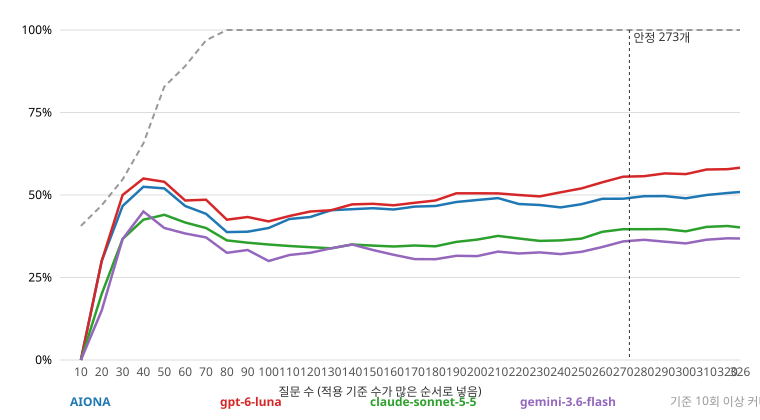

# 기울기 그래프 — 실행 8c61f117e661

질문을 적용 기준 수(k_var)가 많은 순서로 넣었다. k 분포: {0: 1, 1: 1, 2: 10, 3: 2, 4: 1, 5: 9, 6: 73, 7: 80, 8: 68, 9: 41, 10: 33, 11: 4, 12: 3}. 기준 64개(질문으로 셀 수 있는 것), 통과율 = PASS / 질문 수(보류·수집 실패 포함). 순위 안정 허용 오차 ±3pp.

- 모든 기준이 1회 이상 적용되는 질문 수: **303**
- 모든 기준이 10회 이상 적용되는 질문 수: **326**
- 모델 순위·통과율이 안정되는 질문 수: **247** (전체 순위: gpt-6-luna > AIONA > claude-sonnet-5-5 > gemini-3.6-flash)

| 질문 수 | 기준 1회↑ | 기준 10회↑ | AIONA PASS·FAIL·보류 (통과율) | gpt-6-luna PASS·FAIL·보류 (통과율) | claude-sonnet-5-5 PASS·FAIL·보류 (통과율) | gemini-3.6-flash PASS·FAIL·보류 (통과율) | 순위 |
|---|---|---|---|---|---|---|---|
| 10 | 43 | 27 | 0·8·2 (0%) | 0·9·1 (0%) | 0·10·0 (0%) | 0·10·0 (0%) | AIONA > claude > gemini > gpt-6- |
| 20 | 58 | 31 | 7·11·2 (35%) | 6·13·1 (30%) | 4·16·0 (20%) | 4·15·1 (20%) | AIONA > gpt-6- > claude > gemini |
| 30 | 58 | 35 | 13·15·2 (43%) | 10·18·2 (33%) | 7·22·1 (23%) | 5·21·4 (17%) | AIONA > gpt-6- > claude > gemini |
| 40 | 58 | 39 | 16·17·7 (40%) | 14·19·7 (35%) | 9·28·3 (22%) | 7·26·7 (18%) | AIONA > gpt-6- > claude > gemini |
| 50 | 61 | 44 | 21·20·9 (42%) | 21·21·8 (42%) | 13·30·7 (26%) | 12·31·7 (24%) | AIONA > gpt-6- > claude > gemini |
| 60 | 63 | 49 | 25·24·11 (42%) | 25·25·10 (42%) | 18·33·9 (30%) | 17·34·9 (28%) | AIONA > gpt-6- > claude > gemini |
| 70 | 63 | 50 | 31·26·13 (44%) | 30·27·13 (43%) | 19·39·12 (27%) | 19·38·13 (27%) | AIONA > gpt-6- > claude > gemini |
| 80 | 63 | 50 | 36·27·17 (45%) | 36·29·15 (45%) | 22·41·17 (28%) | 21·41·18 (26%) | AIONA > gpt-6- > claude > gemini |
| 90 | 63 | 54 | 42·30·18 (47%) | 42·33·15 (47%) | 26·46·18 (29%) | 26·43·21 (29%) | AIONA > gpt-6- > claude > gemini |
| 100 | 63 | 55 | 43·33·24 (43%) | 46·36·18 (46%) | 30·48·22 (30%) | 31·45·24 (31%) | gpt-6- > AIONA > gemini > claude |
| 110 | 63 | 58 | 49·35·26 (45%) | 53·36·21 (48%) | 36·50·24 (33%) | 36·48·26 (33%) | gpt-6- > AIONA > claude > gemini |
| 120 | 63 | 58 | 57·36·27 (48%) | 59·37·24 (49%) | 41·51·28 (34%) | 41·49·30 (34%) | gpt-6- > AIONA > claude > gemini |
| 130 | 63 | 58 | 61·37·32 (47%) | 63·39·28 (48%) | 43·53·34 (33%) | 41·52·37 (32%) | gpt-6- > AIONA > claude > gemini |
| 140 | 63 | 58 | 65·40·35 (46%) | 68·41·31 (49%) | 46·58·36 (33%) | 42·57·41 (30%) | gpt-6- > AIONA > claude > gemini |
| 150 | 63 | 61 | 72·42·36 (48%) | 73·43·34 (49%) | 51·62·37 (34%) | 45·61·44 (30%) | gpt-6- > AIONA > claude > gemini |
| 160 | 63 | 63 | 76·47·37 (48%) | 79·46·35 (49%) | 53·65·42 (33%) | 47·67·46 (29%) | gpt-6- > AIONA > claude > gemini |
| 170 | 63 | 63 | 83·50·37 (49%) | 88·47·35 (52%) | 60·67·43 (35%) | 54·69·47 (32%) | gpt-6- > AIONA > claude > gemini |
| 180 | 63 | 63 | 89·52·39 (49%) | 94·50·36 (52%) | 64·71·45 (36%) | 57·74·49 (32%) | gpt-6- > AIONA > claude > gemini |
| 190 | 63 | 63 | 95·55·40 (50%) | 99·54·37 (52%) | 71·74·45 (37%) | 61·78·51 (32%) | gpt-6- > AIONA > claude > gemini |
| 200 | 63 | 63 | 101·58·41 (50%) | 106·57·37 (53%) | 78·76·46 (39%) | 68·80·52 (34%) | gpt-6- > AIONA > claude > gemini |
| 210 | 63 | 63 | 102·62·46 (49%) | 109·63·38 (52%) | 79·83·48 (38%) | 69·87·54 (33%) | gpt-6- > AIONA > claude > gemini |
| 220 | 63 | 63 | 108·64·48 (49%) | 114·67·39 (52%) | 83·86·51 (38%) | 75·90·55 (34%) | gpt-6- > AIONA > claude > gemini |
| 230 | 63 | 63 | 111·69·50 (48%) | 122·69·39 (53%) | 87·91·52 (38%) | 77·98·55 (33%) | gpt-6- > AIONA > claude > gemini |
| 240 | 63 | 63 | 118·71·51 (49%) | 130·71·39 (54%) | 92·94·54 (38%) | 82·103·55 (34%) | gpt-6- > AIONA > claude > gemini |
| 250 | 63 | 63 | 127·72·51 (51%) | 140·71·39 (56%) | 101·94·55 (40%) | 89·105·56 (36%) | gpt-6- > AIONA > claude > gemini |
| 260 | 63 | 63 | 132·75·53 (51%) | 150·71·39 (58%) | 107·97·56 (41%) | 97·107·56 (37%) | gpt-6- > AIONA > claude > gemini |
| 270 | 63 | 63 | 139·78·53 (51%) | 156·74·40 (58%) | 111·100·59 (41%) | 102·110·58 (38%) | gpt-6- > AIONA > claude > gemini |
| 280 | 63 | 63 | 144·80·56 (51%) | 164·75·41 (59%) | 115·103·62 (41%) | 104·115·61 (37%) | gpt-6- > AIONA > claude > gemini |
| 290 | 63 | 63 | 147·80·63 (51%) | 169·76·45 (58%) | 117·108·65 (40%) | 106·117·67 (37%) | gpt-6- > AIONA > claude > gemini |
| 300 | 63 | 63 | 155·81·64 (52%) | 179·76·45 (60%) | 125·110·65 (42%) | 113·120·67 (38%) | gpt-6- > AIONA > claude > gemini |
| 310 | 64 | 63 | 157·81·72 (51%) | 180·77·53 (58%) | 126·111·73 (41%) | 113·122·75 (36%) | gpt-6- > AIONA > claude > gemini |
| 320 | 64 | 63 | 162·83·75 (51%) | 186·77·57 (58%) | 130·112·78 (41%) | 118·123·79 (37%) | gpt-6- > AIONA > claude > gemini |
| 326 | 64 | 64 | 166·84·76 (51%) | 190·77·59 (58%) | 131·112·83 (40%) | 120·124·82 (37%) | gpt-6- > AIONA > claude > gemini |
